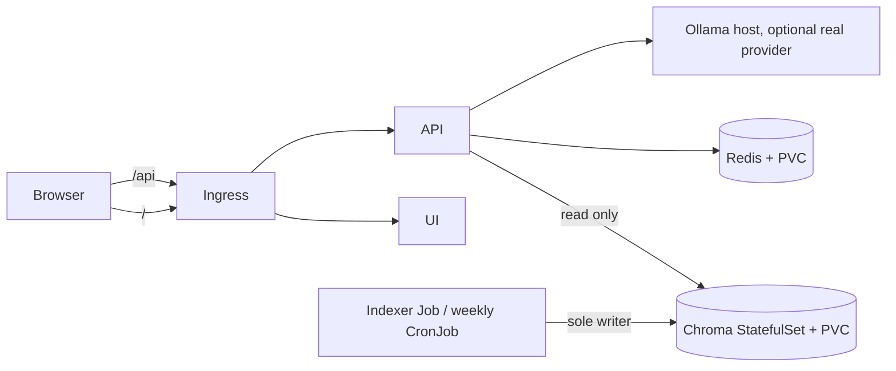

# RAHBAR

RAHBAR is a grounded question-answering service for FAST-NUCES public academic and
student documents. It retrieves passages from an index built by a one-shot Kubernetes
Job, then returns an answer with citations or declines when its evidence is insufficient.
The API only reads Chroma; re-indexing is performed by a Job or the weekly CronJob.

> This repository is being completed in stages. The current Kubernetes overlay uses the
> starter retriever and provider so the cluster plumbing can be demonstrated before the
> real corpus and generation pipeline are enabled. See [WORKLOG](docs/WORKLOG.md) for
> verified status and outstanding requirements.

## Architecture



The API, indexer, and UI are separate images. The ConfigMap provides one embedding-model
pin to both API and indexer. Chroma uses a StatefulSet because its single writable data
directory needs a stable identity and persistent volume. Redis stores the semantic cache
and uses a PVC so restarts do not discard all cache state.

## Requirements

- Docker, Minikube with the Calico CNI, `kubectl`, and `make` in WSL 2 / a Bash shell.
- Python 3.12 for local development and the submission checker.
- To switch to the real RAG configuration: the downloaded corpus and an Ollama host
  listening on port 11434 with the selected LLM and embedding models pulled.

## From a clean clone to a stub answer

Run these commands from the repository root:

```bash
make cluster
make images TAG=dev
kubectl apply -k k8s/overlays/dev
kubectl rollout status statefulset/chroma -n rahbar --timeout=5m
kubectl rollout status deployment/redis -n rahbar --timeout=2m
kubectl wait --for=condition=complete job/indexer -n rahbar --timeout=5m
kubectl rollout status deployment/api -n rahbar --timeout=3m
kubectl rollout status deployment/ui -n rahbar --timeout=2m
```

On Windows with the Docker driver, run `minikube tunnel` in a second WSL terminal. Then
open `http://127.0.0.1/` with the `Host: rahbar.local` header, or ask through the Ingress:

```bash
curl -H 'Host: rahbar.local' -H 'Content-Type: application/json' \
  -d '{"question":"What does the stub handbook say?"}' \
  http://127.0.0.1/api/ask
```

The starter deployment is stub mode. The initial Job writes three fake passages so the
StatefulSet, PVC, Service, Ingress and API can be brought up before model setup.

## Move from stub mode to the real corpus

Copy and review the source list, then fetch the selected public documents and verify the
hashes. Do not commit the downloaded PDFs:

```bash
cp corpus/sources.example.yaml corpus/sources.yaml
make fetch
python corpus/fetch.py --verify
```

Configure the host Ollama service and model names, update `RETRIEVER`, `LLM_PROVIDER`, and
`EMBED_MODEL` in `k8s/base/configmap.yaml`, then rebuild and load the indexer image with
the corpus available to its Job. The exact corpus handoff and real indexer Job settings
will be documented here after that path is implemented and exercised. Re-index after
changing the embedding model; the API will be kept unready if index and query pins differ.

## Endpoints

| Method | Path | Purpose |
| --- | --- | --- |
| GET | `/healthz` | Process liveness; does not depend on downstream services. |
| GET | `/readyz` | Dependency and index readiness. |
| GET | `/metrics` | Prometheus text metrics. |
| POST | `/api/ask` | Ask a question (3–500 characters) and return answer, citations, and retrieval metadata. |

## Development and evaluation

```bash
make install
make test
make lint
make dev
make check
```

Evaluation commands and the golden set will be added after the retrieval and evaluation
functions are implemented. The UI screenshot, measured resource evidence, and cluster
rollout / failure demonstrations are also outstanding; see [WORKLOG](docs/WORKLOG.md).

## Security and attribution

Secrets are created with `make secret` from an environment variable. Never commit a real
key or a populated Secret manifest. AI assistance used during implementation is recorded
in [docs/AI-USAGE.md](docs/AI-USAGE.md).
