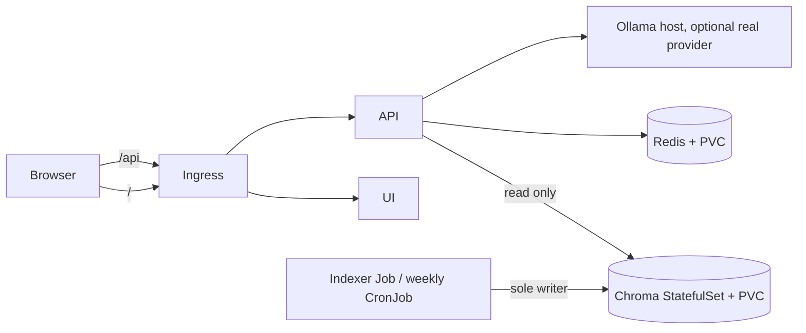

# RAHBAR

[](https://github.com/momnakhan24/rahbar/actions/workflows/ci.yml)

RAHBAR is a grounded question-answering service for FAST-NUCES public academic and
student documents. It retrieves passages from an index built by a one-shot Kubernetes
Job, then returns an answer with citations or declines when its evidence is insufficient.
The API only reads Chroma; re-indexing is performed by a Job or the weekly CronJob.

> `dev` keeps the starter retriever/provider and a dummy index for plumbing checks.
> `prod` selects Chroma retrieval, the Ollama host provider and the real corpus indexer.
> Cluster rollout and measured retrieval evidence are still pending in this workspace;
> see [WORKLOG](docs/WORKLOG.md) for the exact status.

## Architecture



The API, indexer, and UI are separate images. The ConfigMap provides one embedding-model
pin to both API and indexer. Chroma uses a StatefulSet because its single writable data
directory needs a stable identity and persistent volume. Redis stores the semantic cache
and uses a PVC so restarts do not discard all cache state.

## Requirements

- Docker, Minikube with the Calico CNI, `kubectl`, and `make` in WSL 2 / a Bash shell.
- Python 3.12 for local development and the submission checker.
- To switch to the real RAG configuration: the downloaded corpus and an Ollama host
  listening on port 11434 with the selected LLM and embedding models pulled.

## From a clean clone to a stub answer

Run these commands from the repository root:

```bash
make cluster
make images TAG=dev
kubectl apply -k k8s/overlays/dev
kubectl rollout status statefulset/chroma -n rahbar --timeout=5m
kubectl rollout status deployment/redis -n rahbar --timeout=2m
kubectl wait --for=condition=complete job/indexer -n rahbar --timeout=5m
kubectl rollout status deployment/api -n rahbar --timeout=3m
kubectl rollout status deployment/ui -n rahbar --timeout=2m
```

On Windows with the Docker driver, run `minikube tunnel` in a second WSL terminal. Then
open `http://127.0.0.1/` with the `Host: rahbar.local` header, or ask through the Ingress:

```bash
curl -H 'Host: rahbar.local' -H 'Content-Type: application/json' \
  -d '{"question":"What does the stub handbook say?"}' \
  http://127.0.0.1/api/ask
```

The starter deployment is stub mode. The initial Job writes three fake passages so the
StatefulSet, PVC, Service, Ingress and API can be brought up before model setup.

## Move from stub mode to the real corpus

Copy and review the source list, then fetch the selected public documents and verify the
hashes. Do not commit the downloaded PDFs:

```bash
cp corpus/sources.example.yaml corpus/sources.yaml
make fetch
python corpus/fetch.py --verify
```

The production overlay already selects Chroma retrieval, `ollama-host`, and
`nomic-embed-text`. The base Job and CronJob run the real indexer; the dev overlay patches
them to `--dummy`. Copying files into the PVC is an explicit step because Kubernetes
cannot mount the ignored local corpus automatically. After applying the prod overlay and
waiting for the `corpus-data` claim to bind, use the temporary loader pod:

```bash
kubectl apply -f k8s/base/corpus-loader.example.yaml
kubectl wait --for=condition=Ready pod/corpus-loader -n rahbar --timeout=2m
kubectl cp corpus/raw/. rahbar/corpus-loader:/corpus
kubectl delete pod corpus-loader -n rahbar
kubectl create job --from=cronjob/reindex first-index -n rahbar
kubectl wait --for=condition=complete job/first-index -n rahbar --timeout=2h
kubectl rollout status deployment/api -n rahbar --timeout=5m
```

The temporary loader manifest is deliberately excluded from Kustomize. It must be deleted
after copying the corpus. Create the runtime secret only if hosted generation is selected;
the prod overlay uses Ollama and does not require an API key. Set up `host.minikube.internal`
and the `192.168.49.1/32` NetworkPolicy egress address for the actual cluster before use.
Re-index after changing `EMBED_MODEL`; readiness compares the API pin with Chroma metadata.

## Endpoints

| Method | Path | Purpose |
| --- | --- | --- |
| GET | `/healthz` | Process liveness; does not depend on downstream services. |
| GET | `/readyz` | Dependency and index readiness. |
| GET | `/metrics` | Prometheus text metrics. |
| POST | `/api/ask` | Ask a question (3–500 characters) and return answer, citations, and retrieval metadata. |

## Development and evaluation

```bash
make install
make test
make lint
make dev
make check
```

The 17-question real corpus set is [`eval/golden.yaml`](eval/golden.yaml). Once the real
index is available, run `make eval`; the runner writes `eval/results.json` and compares
against `eval/baseline.json`. Do not update the baseline until the set has been reviewed
and a deliberate evaluation run is complete. A tiny offline fixture set is available via
`make eval-fixtures`, but the stub deployment cannot produce meaningful RAG scores. The UI
screenshot, measured resource evidence, and cluster rollout/failure demonstrations remain
outstanding; see [WORKLOG](docs/WORKLOG.md).

## GitHub Actions setup

CI runs on pushes and pull requests. In repository settings, protect `main` and require the
`quality` and `cluster-smoke` CI checks before merge. To enable CD, create a protected
GitHub Environment named `production` with required reviewers, add the base64 kubeconfig as
the `KUBECONFIG_B64` environment secret, and define `API_IMAGE_REPOSITORY`,
`INDEXER_IMAGE_REPOSITORY`, and `UI_IMAGE_REPOSITORY` as environment variables. The
manually triggered CD workflow requires a 40-character image tag and explicit confirmation;
the matching images must already exist in that registry. This repository workflow does not
publish images. Do not store credentials or kubeconfigs in the repository. None of these
GitHub settings are claimed as configured until captured in the evidence bundle.

## Security and attribution

Secrets are created with `make secret` from an environment variable. Never commit a real
key or a populated Secret manifest. AI assistance used during implementation is recorded
in [docs/AI-USAGE.md](docs/AI-USAGE.md).
